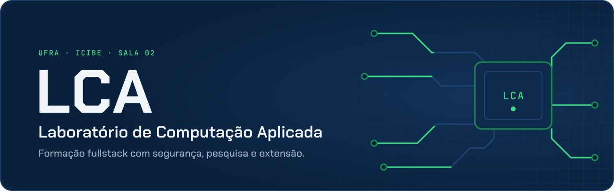
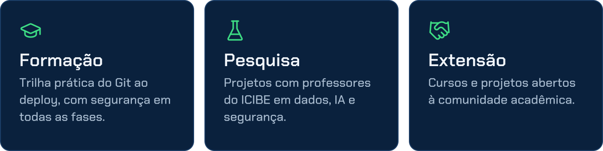
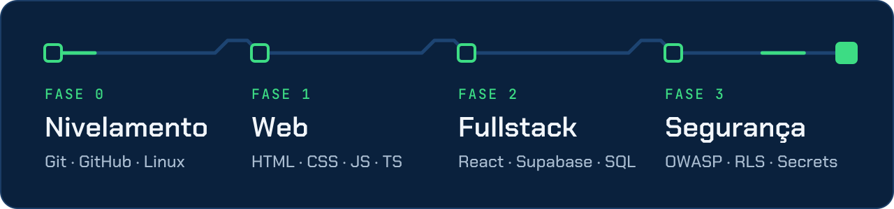

  
  
  

  Laboratório da UFRA que forma desenvolvedores fullstack com base em segurança 
  e produz pesquisa e extensão em computação aplicada.

## Pilares

## Trilha de formação

## Stack

  

## Como contribuir

- **Pull Request com revisão** para todo código. Nada vai direto na `main`.
- **Branches** por tipo: `feat/…` · `fix/…` · `docs/…`
- **Commits** curtos e no imperativo: `feat: adiciona login`

## Coordenação

- **Professores responsáveis:** Profa. Dra. Decíola Fernandes de Sousa · Prof. Dr. Orlando Shigueo Ohashi Junior
- **Coordenação discente:** Marcos Gabriel Rodrigues Baia
- **Contato:** lca@ufra.edu.br

 

LCA · Laboratório de Computação Aplicada · UFRA/ICIBE · Belém, PA

